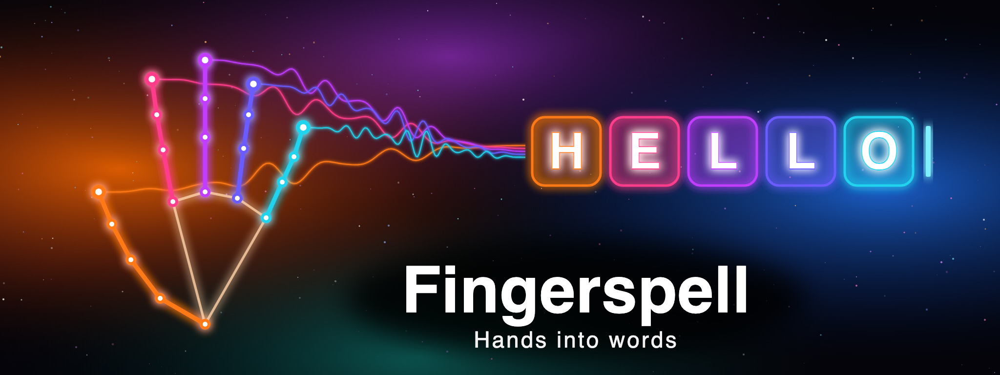
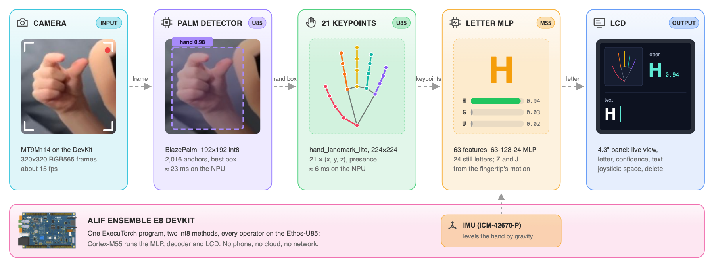

<p align="center"></p>

# Fingerspell

**ASL fingerspelling to text on the Alif Ensemble E8.** Camera → hand detection and 21 keypoints on the Ethos-U85 NPU → letter on the Cortex-M55 → words on the board's LCD. No phone, no cloud, no network.

> Built for the [**Arm + ExecuTorch: Edge AI Challenge**](https://arm-executorch.devpost.com/) · San Francisco State University · October 17–18, 2026

<p align="center">
     
     
     
       
</p>

<p align="center"><b><a href="#what-it-does">What it does</a> · <a href="#at-a-glance">At a glance</a> · <a href="#models">Models</a> · <a href="#hardware">Hardware</a> · <a href="#running-it-on-the-board">Run it</a> · <a href="#changing-the-models">Change the models</a> · <a href="#if-something-does-not-work">Troubleshooting</a> · <a href="#credits">Credits</a></b></p>

<p align="center"><a href="documentation/how-it-works.md"></a> <a href="documentation/landmark-plan.md"></a> <a href="documentation/fingerspell-bringup.md"></a> <a href="documentation/hand-detection-plan.md"></a> <a href="documentation/temporal-average-plan.md"></a> <a href="board/DevKit-E8/README.md"></a></p>

## What it does

A pocket-sized ASL translator. A camera on the **Alif Ensemble E8 DevKit**
watches a signing hand, the Ethos-U85 NPU finds the hand and its 21 keypoints,
a small classifier on the Cortex-M55 turns the keypoints into a letter, and the
letters build up into words on the board's LCD. The aim is a self-contained
device a Deaf signer can hold up to spell a word to someone who does not know
ASL: no phone, no cloud, no network.

<p align="center"><picture>
<source media="(prefers-color-scheme: dark)" srcset="documentation/media/overview-dark.png">

</picture><br><sub>Overview. One frame through the board, about 15 times a second. The letter guesses shown are illustrative.</sub></p>

Built on the Arm `CMSIS-Executorch` example (ExecuTorch + CMSIS-Toolbox on the
Ethos-U85). The work lives on the `landmark/pipeline` branch of
[erictweng/CMSIS-Executorch](https://github.com/erictweng/CMSIS-Executorch).

- **All 26 letters.** The 24 still letters come from the keypoint classifier.
  **Z** and **J** are recognised by their motion: hold D or I, then draw the
  stroke.
- **Text rules.** A letter is appended once its confidence has held for two
  frames; a quick bounce of the hand out of view and back repeats a letter (as
  in "HELLO"). Spaces come from the joystick, not from taking the hand away.
- **Joystick.** RIGHT adds a space, LEFT deletes the last character, DOWN
  clears the text, UP swaps the panel's views (camera large / hand crop small,
  or the reverse).
- **Robust to the room.** The letter decision only ever sees keypoints, never
  pixels, so lighting, background and skin tone do not reach it. The board's
  IMU levels the hand against gravity, so tilting the board does not change
  the letter.
- **LCD.** Live view of the hand box with the skeleton drawn on it, the top
  letter with its probability bar, the next two guesses, stage timings, fps,
  and the committed text.
- **Speed.** About 15 fps with a hand in view. The palm detector is the
  slowest stage at roughly 23 ms; the landmark stage is 6 ms.

## At a glance

| | Value | Source |
|---|---|---|
| Frame rate on the board | **15–16 fps** with a hand in view | [landmark-plan.md](documentation/landmark-plan.md) |
| Palm detector stage | **22.9 ms** (Ethos-U85) | [landmark-plan.md](documentation/landmark-plan.md) |
| Landmark stage (crop + model + decode + MLP) | **6.0 ms** | [landmark-plan.md](documentation/landmark-plan.md) |
| Decoder + panel | ≈ 3 ms (render 2–3 ms of a 10 ms budget) | [how-it-works.md](documentation/how-it-works.md) |
| Letter MLP, held-out | **94.5 %** on keypoints through the board's own pipeline, 96.6 % on MediaPipe keypoints | [landmark-plan.md](documentation/landmark-plan.md) |
| int8 vs float keypoints | 0.8 px median, 4.2 px p90; presence agreement 96 % | [fingerspell-bringup.md](documentation/fingerspell-bringup.md) |
| Program (both models) | 2,265,152 bytes; MRAM 2.57 of 3.44 MB, SRAM0 3.82 of 3.94 MB | [landmark-plan.md](documentation/landmark-plan.md) |
| Decoder host tests | 361 checks; pure C99, same code on laptop and board | [how-it-works.md](documentation/how-it-works.md) |

Letter accuracy on live signers has not been scored yet; the numbers above are on held-out dataset keypoints.

## Models

One ExecuTorch program, two methods, int8 end to end, every operator on the NPU:

| Stage | Model | Input | Runs on |
|---|---|---|---|
| Hand detection | MediaPipe BlazePalm (palm_detection_lite) | 192x192 RGB | Ethos-U85 |
| Keypoints | MediaPipe hand_landmark_lite | 224x224 rotated hand crop | Ethos-U85 |
| Letter | MLP 63-128-24 trained on Marxulia + board keypoints | 21 x (x, y, z) | Cortex-M55 |

<details><summary>The pipeline as text</summary>

```
camera 320x320  ->  BlazePalm (NPU)  ->  hand box  ->  hand_landmark_lite (NPU)
  ->  21 keypoints  ->  keypoint MLP (CPU)  ->  letter + confidence  ->  decoder  ->  LCD
```

</details>

## Hardware

- Alif Ensemble E8 DevKit with its MT9M114 camera module and the 4.3" LCD
  (ILI9806E, connector J21). The on-board ICM-42670-P IMU is used for
  orientation and the joystick for editing.
- One USB-C cable on **PRG USB**: power, J-Link debugger and the UART bridge.
- Jumpers at their defaults, **JP5 on 1-2**, **JP7 on 3-4**. Never move
  jumpers with power applied.
- **SW4** picks what the UART bridge connects to: `SEUART` for programming
  the boot table with Alif SETOOLS, `UART4` for the app's console.

## Running it on the board

### 1. Install the host tools (once)

1. [VS Code](https://code.visualstudio.com/) with the **Keil Studio Pack**
   (`Arm.keil-studio-pack`) and **Python** (`ms-python.python`) extensions.
   Sign in with an Arm account when asked; the free Keil MDK Community license
   is enough.
2. Open this folder in VS Code. The Arm Tools Environment Manager offers to
   install what `vcpkg-configuration.json` pins (CMSIS-Toolbox 2.15,
   Arm Compiler 6, CMake, Ninja). Accept, and accept the pack installation
   (`PyTorch::ExecuTorch`, `AlifSemiconductor::Ensemble`, CMSIS).
3. **Alif SETOOLS** V1.110.000 or later from the
   [Alif software and tools page](https://alifsemi.com/support/software-tools/ensemble/)
   (login required). Unpack it and point VS Code at it in your user settings:

   ```json
   "alif.setools.root": "/absolute/path/to/setools"
   ```

4. **SEGGER J-Link Software** V8.42 or later from
   [segger.com](https://www.segger.com/downloads/jlink/).
5. Copy the VS Code tasks into place (git ignores the target):

   ```bash
   cp .vscode.d/tasks.json .vscode/tasks.json
   ```

### 2. Prepare the board (once)

The Secure Enclave boots the M55 from a table of contents in MRAM, and the
debugger needs that table to point at a debug stub.

1. SW4 to **SEUART**, PRG USB attached.
2. In the SETOOLS directory run `updateSystemPackage -d` once (it picks the
   serial port and makes the E8 the default target: answer yes).
3. **Terminal > Run Task > Alif: Install M55_HP debug stubs (DevKit-E8, single core configuration)**.
   Choose COM port discovery the first time. If `app-write-mram` reports a
   different board revision, answer `y`.
4. SW4 back to **UART4**.

Repeat this only if another project has reprogrammed the boot table.

### 3. Build and flash

In the CMSIS view open **Manage Solution**, pick the **DevKit-E8**
target-type and click **Apply**. Then click **Build**, then **Run** (or
**Debug** to stop at `main`). Keil Studio loads the image over the on-board
J-Link and resets the board.

The same from a terminal, with the vcpkg tools on your `PATH`:

```bash
cbuild setup cmsis-executorch.csolution.yml --active DevKit-E8 --packs
cbuild cmsis-executorch.csolution.yml --active DevKit-E8
printf 'connect\nh\nloadfile "out/cmsis-executorch/DevKit-E8/Debug/cmsis-executorch.hex"\nr\ng\nqc\n' > /tmp/load.jlink
JLinkExe -device AE822FA0E5597LS0_M55_HP -if SWD -speed 4000 -autoconnect 1 -NoGui 1 -CommandFile /tmp/load.jlink
```

Build one target at a time: two concurrent `cbuild` runs wipe each other's
`tmp/` tree. If J-Link reports "CPU could not be halted" while the camera is
streaming, run the load again; it usually works on the second try.

The repository ships the generated AI layer (`ai_layer/`), so no Python is
needed to build.

### 4. Use it

1. Power on with SW4 on **UART4**. The LCD shows the live camera view, and
   the console (Serial Monitor on the PRG USB port, 115200 8N1) prints the
   Ethos-U version, the self-test `Test_result: PASS`, then one line per frame:

   ```text
   A 0.93 S 0.04 T 0.01 | box 112,84 96x96 s0.87 p0.98 | det 22.9ms cam 2.0ms lm 6.0ms ui 1.6ms | 15.5 fps
   ```

2. Hold your hand about 30 to 60 cm from the camera, fingers up, so that the
   box on the LCD is at least 75 px wide. Small or far hands lose presence.
3. Sign a letter and hold it still; it appears in the text line when the bar
   turns green. For **Z** or **J**, hold D or I until the panel shows
   "HELD: MOVE FOR Z", then draw the stroke.
4. Push the joystick RIGHT to add a space. DOWN clears the text, LEFT
   deletes one character.

If the UART is quiet but the board is running, read the live state over
J-Link instead:

```bash
.venv/bin/python tests/board_telemetry.py --count 10 --interval 0.5
```

## Changing the models

Only needed to retrain or re-export. Run **Terminal > Run Task > Setup Python
virtual environment (uv)** once (Python 3.12; several GB of PyTorch), then:

| Task | Command |
|---|---|
| Re-export the two NPU models and the MLP weights into `ai_layer/` | task **Create AI layer**, or `.venv/bin/python create_ai_layer.py cmsis-executorch.cbuild-mlops.yml` |
| Capture keypoints of your own hand from the board, per letter | `tests/capture_keypoints.py` |
| Extract training keypoints through the board's own pipeline | `ml/keypoint_dataset_board.py` |
| Retrain the letter MLP | `ml/keypoint_train.py` (writes `model/keypoint_mlp.npz`) |
| Convert the MediaPipe TFLite models | `ml/blazepalm_export.py`, `ml/handlandmark_export.py` |
| Host tests (no board) | `tests/test_decoder_host.py`, `tests/test_landmark.py`, `tests/test_orient.py`, `tests/test_input_host.py` |
| Board tests | the same scripts with `FS_HW=1`, plus `tests/test_display.py`, `tests/letter_check.py` |

After **Create AI layer**, rebuild and flash.

## If something does not work

- **No console output:** SW4 is still on `SEUART`, or the port was opened
  before the switch was moved. Set `UART4` and reopen the port. The loop may
  still be running: check with `tests/board_telemetry.py`.
- **J-Link connects but never stops at `main`:** the boot table does not
  point at the debug stub. Repeat "Prepare the board".
- **Debug hangs at "Connecting":** the target-set was switched to JTAG. Keep
  SWD.
- **`app-write-mram` gets no answer:** press reset while it waits, check SW4
  is on `SEUART`, close any terminal holding the port.
- **Frames almost black:** the sensor's auto-exposure is enabled in
  `src/fs_camera.c`; make sure you built from this branch.
- **Letters flicker or the wrong letter commits:** the decoder's thresholds
  live at the top of `src/fs_decoder.c` (`commit_threshold`, `commit_frames`,
  `space_ms`, `release_ms`).
- **Stage times print `0.0ms`:** they come from the 100 MHz REFCLK counter,
  not the DWT; if you see zeros you are running an old image.

## Read on

- [documentation/how-it-works.md](documentation/how-it-works.md): one frame
  through the code, stage by stage, with the file for each.
- [documentation/landmark-plan.md](documentation/landmark-plan.md): the
  pipeline design, decisions and a dated status log.
- [documentation/fingerspell-bringup.md](documentation/fingerspell-bringup.md):
  bring-up report, camera, display and the gotchas met on the way.
- [documentation/hand-detection-plan.md](documentation/hand-detection-plan.md)
  and [hand-detection-handoff.md](documentation/hand-detection-handoff.md):
  the palm detector.
- [documentation/temporal-average-plan.md](documentation/temporal-average-plan.md):
  how the letter stream is smoothed before it commits.
- [documentation/example.md](documentation/example.md): the original Arm
  ExecuTorch example and the AI-layer flow.
- [board/DevKit-E8/README.md](board/DevKit-E8/README.md): the board layer,
  memory map, camera and LCD configuration.

## Credits

- [Arm-Examples/CMSIS-Executorch](https://github.com/Arm-Examples/CMSIS-Executorch): the ExecuTorch + CMSIS-Toolbox template this project starts from.
- [MediaPipe](https://github.com/google-ai-edge/mediapipe) (Google): the palm_detection_lite and hand_landmark_lite models.
- Marxulia ASL alphabet images: training keypoints for the letter MLP.

## License

[Apache-2.0](LICENSE), as the Arm template. Figures in `documentation/media/` are generated by `make_banner_svg.py` and `make_overview_svg.py` in the same folder.
